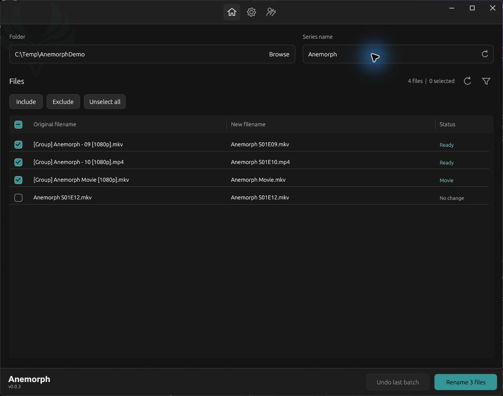
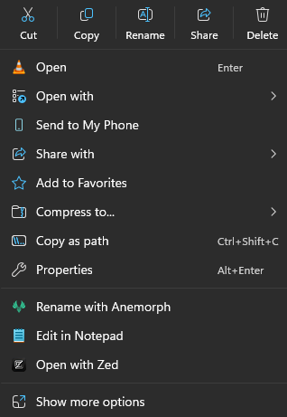

# Anemorph

**Tidy up your anime, TV, and movie filenames.**

Anemorph is a free, open-source Windows app that renames many video files at once. Choose a folder, check what the new names will look like, and rename the files you want. Your videos stay exactly the same.

[**Download Anemorph 0.0.3**](https://github.com/yaboirar/Anemorph/releases/tag/v0.0.3) · [How to use it](docs/usage.md) · [What's new](CHANGELOG.md#003---2026-10-28)

## What can it do?

- **Rename a whole folder at once.** Save yourself the work of changing every filename by hand.
- **Keep the episode numbers.** If your folder contains episodes 1, 4, and 19, the app keeps those numbers instead of changing them to 1, 2, and 3.
- **Show every new name before you rename.** Leave out any file you want, and see when two files would end up with the same name.
- **Undo your last rename.** Put the previous filenames back if you change your mind.
- **Use your own naming style.** Choose how episodes and movies should be named, and tell the app when a file is a movie.
- **Open it from File Explorer.** Right-click your videos and choose **Rename with Anemorph**.

No account is needed. Your files stay on your computer, and the app only changes their names.

## What's new in 0.0.3?

**The repeated right-click option is fixed.** File Explorer should show one **Rename with Anemorph** option.

**Uninstall no longer forces File Explorer to close.** The app removes its own files and settings while leaving your videos alone. Reinstalling also no longer leaves the right-click menu setting stuck on **Working…**.

**There's a Repair button in Settings.** It reloads your saved settings, checks the folder again, and restores Anemorph's right-click option if it has stopped working. Repair and Uninstall are together in one place.

**The app is easier to use.** Buttons are clearer, right-click choices are separated, and the file counts sit beside refresh and filter. You can also choose from **11 languages**.

We also checked large folders and tested the app without relying on a gaming graphics card. A preview of 50,000 filenames took about **0.2 seconds** on the test computer. Speed will vary on other computers. [See the test results](docs/performance.md).

## Get started

1. Download **Anemorph-Setup-0.0.3.exe** from the [downloads page](https://github.com/yaboirar/Anemorph/releases/tag/v0.0.3) and open it to install the app.
2. Choose a folder, paste its path, or drag it into Anemorph.
3. Check the series name and the new filenames. Choose which files to include.
4. Click **Rename**.

Use **Undo last batch** to put the previous names back.

| Before | After |
| :--- | :--- |
| `[Group] Anemorph - 09 [1080p].mkv` | `Anemorph S01E09.mkv` |
| `[Group] Anemorph Movie [1080p].mp4` | `Anemorph Movie.mp4` |

Want to use it without installing? Download **Anemorph-v0.0.3-windows.zip**, extract it, and open **Anemorph.exe**. Use the installer if you also want the right-click option in File Explorer.

## Right-click your videos

On Windows 11, you can choose whether Anemorph appears straight away or under **Show more options**. Find this under **Settings > Integration**.

Windows may ask you to approve the first-menu option. You can decline and still use Anemorph under **Show more options**. Windows may also show an **unknown publisher** warning when you open the installer.

## Choose what works for you

- Choose the video file types you want to see. You can select several types together, or leave the filter empty to show them all.
- Choose your own episode and movie names in **Configuration**.
- Change the language and appearance in **Settings**.

Supported video file types: **MKV, MP4, MOV, AVI, WebM, M4V**, WMV, FLV, MPG, MPEG, MPE, M2V, TS, MTS, M2TS, VOB, OGV, OGM, 3GP, 3G2, ASF, DIVX, F4V, MXF, RM, and RMVB.

Languages: English (US/UK), Russian, Spanish, Portuguese, Turkish, German, Japanese, Korean, Simplified Chinese, and Modern Standard Arabic.

## Need more?

- [User guide](docs/usage.md)
- [What's changed](CHANGELOG.md)
- [Report a problem or suggest an idea](https://github.com/yaboirar/Anemorph/issues)
- [Test results and known limits](docs/performance.md)
- [Build the app yourself](docs/building.md) · [Contribute](CONTRIBUTING.md)

Created by [@yaboirar](https://github.com/yaboirar).

The code is available under the [MIT license](LICENSE). The supplied Anemo artwork has separate terms and is not covered by that license. See [third-party notices](THIRD_PARTY_NOTICES.md) and [dependency licenses](DEPENDENCY_LICENSES.md).
